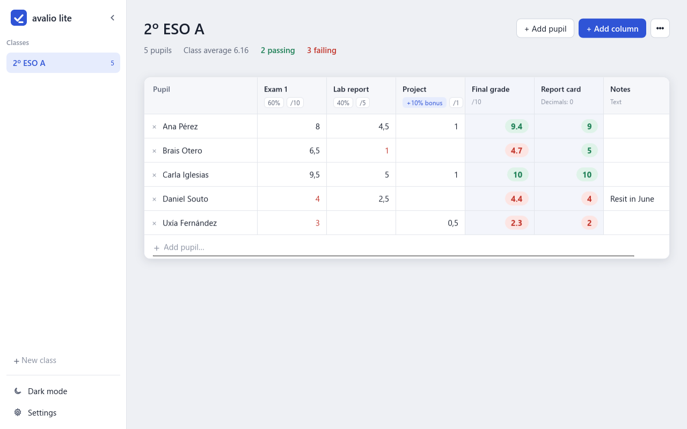
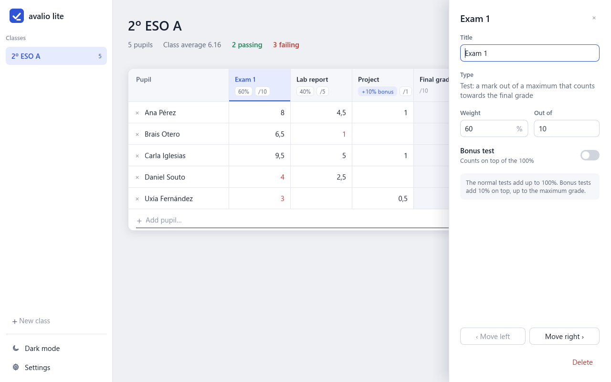
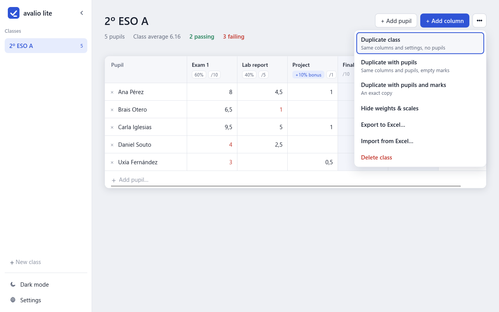
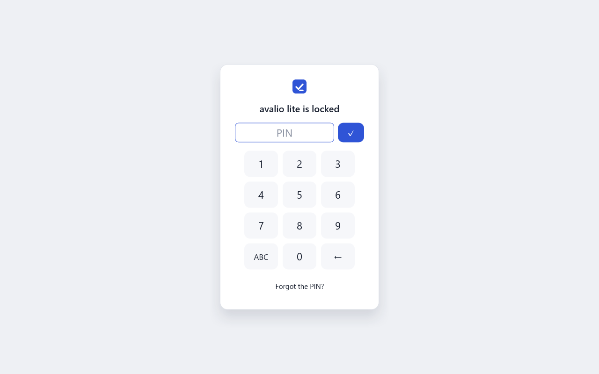
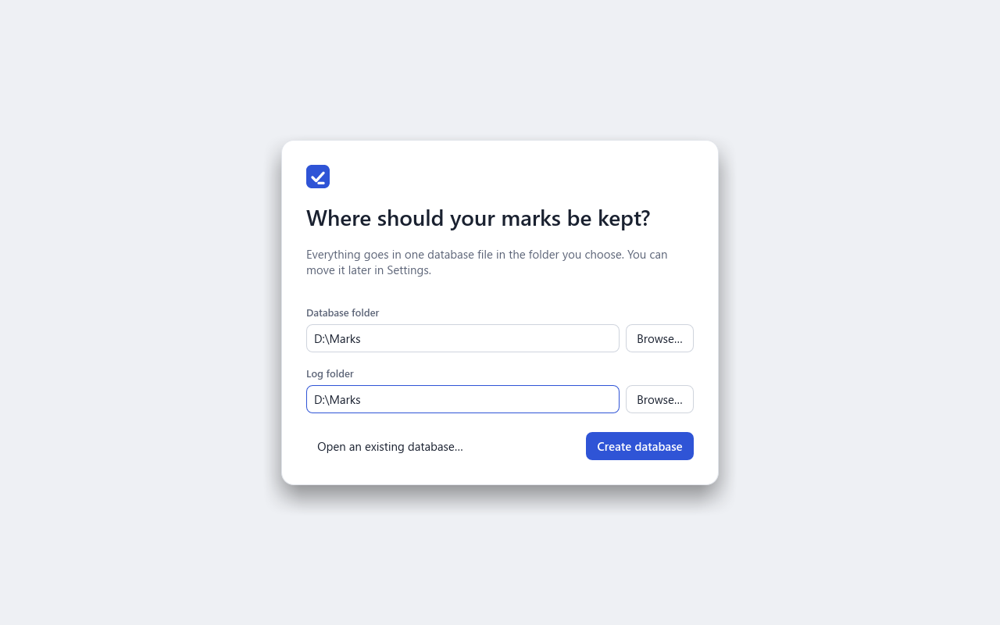
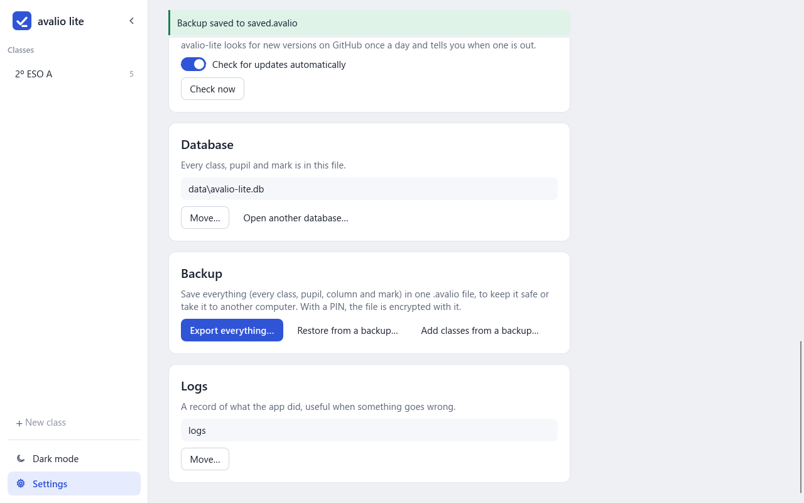
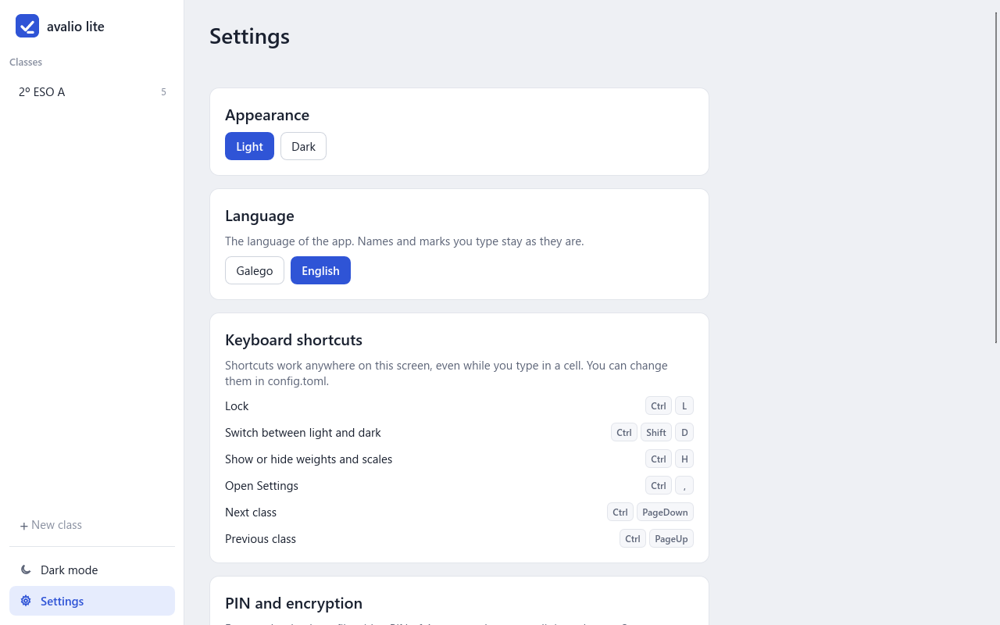
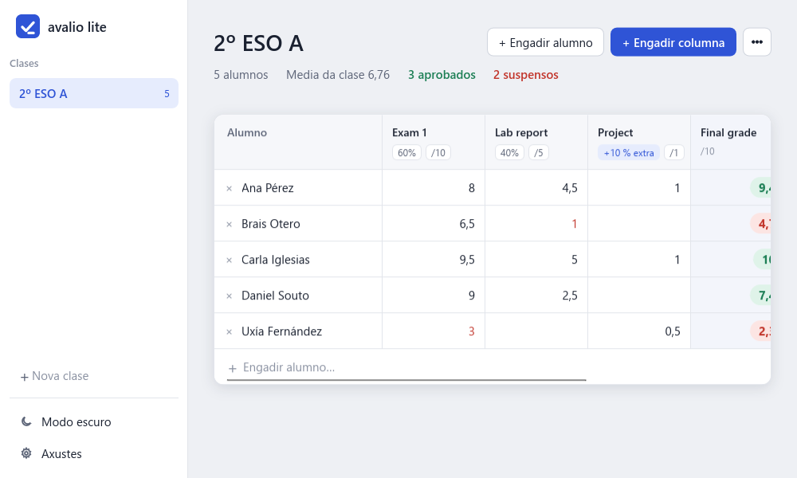

[//]: # ( ---------------------------------------------------------------------- )
[//]: # (+ Authors: 	Ran# <ran.hash@proton.me> )
[//]: # (+ Created: 	2026/10/27 19:34:10.260648 )
[//]: # (+ Revised: 	2026/11/13 15:55:15.348531 )
[//]: # ( ---------------------------------------------------------------------- )

<p align="center"></p>

<h1 align="center">avalio lite</h1>

<p align="center"><b>Your class marks in one simple, private app.</b><br>
A gradebook for teachers that works like a spreadsheet, does the maths for you, and keeps everything on your own computer.</p>

<p align="center">
  <a href="https://github.com/Ran-n/avalio-lite/releases/latest"></a>
</p>

<p align="center">
  <a href="https://github.com/Ran-n/avalio-lite/releases"></a>
  <a href="https://gitlab.com/Ran-n/avalio-lite/-/releases"></a>
  <a href="https://codeberg.org/ran-n/avalio-lite/releases"></a>
</p>

<p align="center">
  <a href="CHANGELOG.md"></a>
  
  
  <a href="LICENSE"></a>
</p>

<picture>
  <source media="(prefers-color-scheme: dark)" srcset="tests/desktop/baselines/sheet-dark-1280x800@100.png">
  
</picture>

<p align="center">
  <a href="#why-avalio-lite">Why</a> ·
  <a href="#a-closer-look">Screenshots</a> ·
  <a href="#download-and-install">Download</a> ·
  <a href="#getting-started">Getting started</a> ·
  <a href="#how-grades-are-worked-out">Grades</a> ·
  <a href="#your-data-stays-with-you">Privacy</a> ·
  <a href="#questions">Questions</a> ·
  <a href="#install--run-from-source">From source</a> ·
  <a href="#technical-details">Docs</a>
</p>

## Why avalio lite?

- **As easy as a spreadsheet.** Each class is one sheet: pupils down the side, your tests and notes across the top. Type a mark and you're done. There's no Save button, because everything saves as you type.
- **The maths is done for you.** Give each test a weight and a maximum, and the app works out final grades, averages and roundings straight away. Extra-credit tests are supported, and passing and failing marks are colour-coded.
- **Private by design.** No cloud, no tracking. Your marks live in one file in a folder you choose; add a PIN and the file is encrypted. The app goes online only to check its licence.
- **Works with Excel.** Export a class to Excel, or bring pupils and marks in from a spreadsheet.
- **Easy to back up.** Save everything to a single file, then restore it later or on another computer.
- **Feels at home.** Available in Galician and English, with light and dark themes and keyboard shortcuts.

## A closer look

<table>
  <tr>
    <td width="50%">
      <picture>
        <source media="(prefers-color-scheme: dark)" srcset="tests/desktop/baselines/column-panel-dark-1280x800@100.png">
        
      </picture>
      <p align="center"><b>Set up each test</b><br>Weight, maximum mark, extra credit</p>
    </td>
    <td width="50%">
      <picture>
        <source media="(prefers-color-scheme: dark)" srcset="tests/desktop/baselines/sheet-menu-dark-1280x800@100.png">
        
      </picture>
      <p align="center"><b>Excel in and out</b><br>Export a class, or import pupils and marks</p>
    </td>
  </tr>
  <tr>
    <td>
      <picture>
        <source media="(prefers-color-scheme: dark)" srcset="tests/desktop/baselines/lock-dark-1280x800@100.png">
        
      </picture>
      <p align="center"><b>Lock it with a PIN</b><br>Your file is encrypted with it</p>
    </td>
    <td>
      <picture>
        <source media="(prefers-color-scheme: dark)" srcset="tests/desktop/baselines/setup-dark-1280x800@100.png">
        
      </picture>
      <p align="center"><b>Your folder, your data</b><br>You choose where your marks are kept</p>
    </td>
  </tr>
  <tr>
    <td>
      <picture>
        <source media="(prefers-color-scheme: dark)" srcset="tests/desktop/baselines/settings-backup-dark-1280x800@100.png">
        
      </picture>
      <p align="center"><b>One-click backups</b><br>Export everything, restore, or merge in classes</p>
    </td>
    <td>
      <picture>
        <source media="(prefers-color-scheme: dark)" srcset="tests/desktop/baselines/settings-dark-1280x800@100.png">
        
      </picture>
      <p align="center"><b>Make it yours</b><br>Light or dark theme, language, shortcuts</p>
    </td>
  </tr>
  <tr>
    <td colspan="2">
      <p align="center"></p>
      <p align="center"><b>En galego tamén</b> · Also in Galician, with decimal commas</p>
    </td>
  </tr>
</table>

## Download and install

avalio lite is a **Windows** app. Download the latest release from [GitHub](https://github.com/Ran-n/avalio-lite/releases), [GitLab](https://gitlab.com/Ran-n/avalio-lite/-/releases) or [Codeberg](https://codeberg.org/ran-n/avalio-lite/releases); all three have the same files. Pick one:

| File | Choose it if… |
|---|---|
| `avalio-lite-<version>-setup.exe` | You want a normal install, with a Start-menu entry, an optional desktop icon and an uninstaller. It doesn't need administrator rights. |
| `avalio-lite-<version>-portable.exe` | You want one file you can run from anywhere, even a USB stick, without installing anything. |

Each file comes with a `.sig` file. The app uses it to check its own updates; you don't need to download it.

> [!NOTE]
> The app is free, but it isn't in an app store, and its files aren't signed with a Windows certificate. If Windows shows **"Windows protected your PC"**, click **More info → Run anyway**. Alternatively, right-click the file → **Properties** → tick **Unblock**.

## Getting started

1. **Choose a folder** for your marks when the app first opens (`Documents\avalio-lite` is suggested).
2. **Enter your licence key**, the `BRN-…` key you received by email, and press **Activate**.
3. **Add a class:** type its name in **+ New class** and press Enter.
4. **Add pupils:** in the last row, type the first name, press Enter, type the surname and press Enter again.
5. **Add columns** with **+ Add column**, for example two tests and a final grade. Click a column's header to set its weight and maximum mark.
6. **Type marks.** The final grade, the class average and the pass/fail count update straight away.

The **[user guide](docs/user-guide.md)** explains every feature in detail: column types and how grades are calculated, Excel import, keyboard shortcuts, backups and PINs.

## How grades are worked out

Each test counts for the share of the final grade you give it. Here is Ana's row from the screenshot above, with a final grade out of 10:

| Test | Her mark | Counts for | Adds to the final grade |
|---|---|---|---|
| Exam 1 | 8 / 10 | 60 % | 0.8 × 60 % × 10 = **4.8** |
| Lab report | 4.5 / 5 | 40 % | 0.9 × 40 % × 10 = **3.6** |
| Project *(extra credit)* | 1 / 1 | +10 % | 1.0 × 10 % × 10 = **1.0** |
| **Final grade** | | | **9.4**, a pass (green) |

- The normal tests' shares should add up to 100 %. Until they do, the app shows a warning and greys out the final grades.
- Extra-credit tests add on top, but a final grade never goes above its maximum.
- A test with no mark yet counts as 0.
- You can also add an **average** column, or a **rounded** column for report cards (9.4 → 9).

## Your data stays with you

- Everything is kept in **one file, in a folder you choose**. You can move it later from Settings.
- The app connects to the internet **only to check its licence** (with Clavren, Breren's licence server) **and to look for a new version on GitHub**, which you can turn off. Your marks never leave your computer, and there is no tracking.
- With a **PIN**, the file is encrypted with AES-256 (via [SQLCipher](https://www.zetetic.net/sqlcipher/)). Without the PIN, nobody can read it.
- **Uninstalling never deletes your marks.**

> [!WARNING]
> **If you forget your PIN, your marks can't be recovered, by anyone, including the developer.** Keep the PIN somewhere safe, and make a backup now and then (**Settings → Backup → Export everything…**).

## Questions

<details>
<summary><b>Is it free?</b></summary>

Yes, for personal and non-commercial use, such as a teacher keeping their own classes. Commercial use, such as a company selling it or building it into a product, needs a revenue-share agreement. See the [PayBack License (PBL) v2.0](LICENSE).
</details>

<details>
<summary><b>Do I need a licence?</b></summary>

Yes. The app asks for a licence key (it looks like `BRN-XXXX-XXXX-XXXX-XXXX`) the first time it opens. It needs the internet to activate the key; after that, it checks once a day when the computer is online, and works offline for up to 30 days at a time. A key works on one computer (one Windows account) at a time. To move it to a new computer, write to support.avalio.lite@breren.com. Without a valid licence the app stays locked, but **Back up my data** still saves all your marks.
</details>

<details>
<summary><b>How do I update?</b></summary>

The app looks for a new version once a day and shows a bar above the sheet when one is out. Press **Update now**: it downloads the new version, checks that it really comes from avalio lite, installs it and opens again. Your marks and settings stay as they were. **Settings → Updates** turns the daily check off, or looks straight away.
</details>

<details>
<summary><b>Does it work on Mac, Linux, tablets or phones?</b></summary>

No. avalio lite is a Windows app only.
</details>

<details>
<summary><b>Can I use it on two computers?</b></summary>

Yes. Put the portable version and your database folder on a USB stick, or export a backup on one computer and restore it on the other. **Open another database…** in Settings also opens a database file copied from elsewhere.
</details>

<details>
<summary><b>How are final grades calculated?</b></summary>

See [How grades are worked out](#how-grades-are-worked-out) for a worked example, and the [user guide](docs/user-guide.md#columns) for every column type.
</details>

<details>
<summary><b>Can I bring my marks in from Excel?</b></summary>

Yes. **⋯ → Import from Excel…** reads pupils from column A of an .xlsx, .xls or .ods file and fills in marks under columns with matching titles. It asks before replacing marks already there.
</details>

<details>
<summary><b>I found a bug or have an idea.</b></summary>

Open an issue on [GitHub](https://github.com/Ran-n/avalio-lite/issues), [GitLab](https://gitlab.com/Ran-n/avalio-lite/-/issues) or [Codeberg](https://codeberg.org/ran-n/avalio-lite/issues). [CONTRIBUTING.md](CONTRIBUTING.md) says what to include.
</details>

## Install / run from source

You need Windows with the MSVC C++ build tools, [Rust](https://rustup.rs/) and [Strawberry Perl](https://strawberryperl.com/), plus [Inno Setup 6](https://jrsoftware.org/isinfo.php) if you also want the installer. Clone into a short path (OpenSSL's build fails on long ones), then, in PowerShell:

```powershell
git clone https://codeberg.org/ran-n/avalio-lite.git C:\src\avalio-lite
cd C:\src\avalio-lite
. .\scripts\use-perl.ps1   # Strawberry Perl first on PATH for this session
```

**Run it** straight from the source:

```powershell
cargo run --release        # builds (the first time compiles OpenSSL and takes a while), then opens the app
```

**Install it:** build it once, then use the result like the portable release.

```powershell
cargo build --release      # writes target\release\avalio-lite.exe
```

`target\release\avalio-lite.exe` is the whole app in one file: run it from there or copy it anywhere. To get an installer instead, see [Building from source](docs/development.md#building-from-source), which also has the exact install commands for each tool.

## Technical details

The app uses [Slint](https://slint.dev/) 1.18 for its desktop UI and [Rust](https://www.rust-lang.org/) for the application logic. Data is stored locally in [SQLite](https://sqlite.org/), accessed through `rusqlite`, with [SQLCipher](https://www.zetetic.net/sqlcipher/) encryption when a PIN is set. Dependency versions are defined in [Cargo.toml](Cargo.toml).

The full technical documentation lives in separate files:

| Document | What's in it |
|---|---|
| [User guide](docs/user-guide.md) | Every feature in detail: column types and the grade formulas, accepted marks and limits, Excel import/export, keyboard shortcuts and `config.toml`, data and log locations, backups, PIN encryption (SQLCipher, AES-256) and how strong a PIN to choose |
| [Development](docs/development.md) | Building from source (Rust, Strawberry Perl, Inno Setup), the test suites (headless UI, desktop pixel tests, golden files, coverage and mutation testing), the source layout, translations, schema migrations and releasing |
| [Design decisions](docs/design-decisions.md) | Why the code is laid out as it is: feature folders, the dependency rules, file sizes |
| [Contributing](CONTRIBUTING.md) | Reporting bugs, suggesting features, submitting changes and the commit style |
| [Changelog](CHANGELOG.md) | What changed in each version |

## License

avalio lite is released under the [PayBack License (PBL) v2.0](LICENSE): free for personal and non-commercial use.
